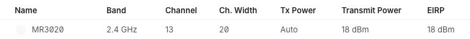
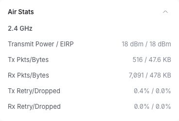

# TP-Link TL-MR3020 v1 with OpenWrt and UniFi

Manage a **TP-Link TL-MR3020 v1** from **UniFi Network** with a small custom ucode agent. The build runs on the original **4 MiB flash and 32 MiB RAM**, without a USB drive, extroot, or hardware memory upgrades.

## What works

Tested on one physical MR3020 v1 with a Dream Router 7 running UniFi Network 11. Adoption, two 2.4 GHz WPA2 SSIDs, per-client VLAN assignment, Wi-Fi statistics, and LLDP upstream port discovery worked on hardware. Lock to AP enforcement passed in a VM connected to the same controller.

The agent presents the AP to UniFi as an **AC Lite**, an older compatibility profile for basic AP management. It advertises the MR3020’s actual hardware capabilities: one 2.4 GHz Wi‑Fi 4 radio, 1×1, and one 100 Mbps Ethernet port. You can name the device **MR3020** in the console. Update this build over SSH with OpenWrt sysupgrade. Transmit power is reported from the driver and can be set in OpenWrt.

## OpenWrt base

The firmware uses **OpenWrt 19.07.10**, the last official release for the 4 MiB flash and 32 MiB RAM class. It is built from the official ar71xx/tiny ImageBuilder and the MR3020 v1 profile. The project retains the original kernel, drivers, and core networking. It adds a newer Dropbear SSH server and the agent, disables IP forwarding, and exposes the temporary UniFi adoption listener only during initial adoption. A small hostapd integration change supports per-client VLANs. OpenWrt 19.07 is end of life. [OpenWrt source](https://github.com/openwrt/openwrt/tree/v19.07.10) · [OpenWrt 4/32 hardware notes](https://openwrt.org/supported_devices/openwrt_on_432_devices)

## Build and set up

1. Check the label for **TL-MR3020 v1**. Follow the [build guide](docs/stable-base.md) and [installation and recovery guide](docs/recovery.md).
2. After first boot, use wired SSH and set the root password with `passwd`.
3. Set the Wi-Fi regulatory country for your location. Edit `/etc/mr3020.json` to set `controller` to your UniFi Network controller's IPv4 address, and set `enabled` and `allow_adoption` to `true` for first adoption. Run `/etc/init.d/mr3020 restart`.
4. Adopt the AP in UniFi and assign its Wi-Fi settings. Once adoption is complete, set `allow_adoption` back to `false` and restart the agent.

## Credits

- [OpenWrt](https://github.com/openwrt/openwrt), [ucode](https://github.com/jow-/ucode), and [Dropbear](https://github.com/mkj/dropbear) provide the firmware base, scripting runtime, and SSH server.
- [antoniocosta/unifi-openwrt](https://github.com/antoniocosta/unifi-openwrt) documents the UniFi inform protocol. [yesrab/openUF](https://github.com/yesrab/openUF) provided additional protocol and compatibility references. This project's agent is a separate ucode implementation.
- [thaneb's MR3020 extroot project](https://github.com/thaneb/TL-MR3020-OpenWRT-Extroot-Ready) provided a reference for small 19.07 builds. [Mbed TLS](https://github.com/Mbed-TLS/mbedtls) provides the inform codec's cryptography.

See [LICENSE](LICENSE) and [MBEDTLS-LICENSE](MBEDTLS-LICENSE).
